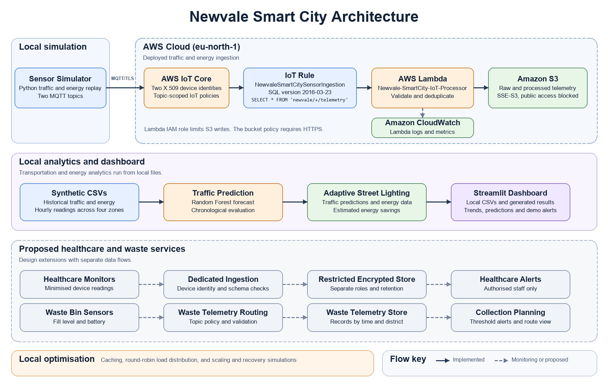

# Newvale Smart City Infrastructure

Cloud Computing Modular Assignment 8. The Newvale lab combines an AWS ingestion pipeline for traffic and energy telemetry with local traffic forecasting, adaptive street-lighting simulation, and a Streamlit dashboard.



Open the PNG in draw.io to edit the embedded diagram. [Draw.io editable PNG format](https://github.com/jgraph/drawio/wiki/Import-and-Export#editable-png-and-svg)

## Submission files

- [Deployment and simulation report](docs/Cloud-Based-SmartCity-M8-Report.docx), including the security and costing model.
- [Presentation slides](docs/Cloud-Based-SmartCity-M8-Presentation.pptx).
- [Traffic forecast chart](results/traffic_prediction_chart.html) and [adaptive lighting chart](results/adaptive_lighting_chart.html).

## Implementation

- **AWS lab (Stockholm, `eu-north-1`).** A Python simulator publishes sample records via MQTT over TLS. AWS IoT Core uses two certificate-authenticated Things. The `NewvaleSmartCitySensorIngestion` rule routes telemetry to `Newvale-SmartCity-IoT-Processor`, which validates and processes events for S3 storage. CloudWatch records invocations, errors and duration. The lab uses topic-scoped IoT policies, an IAM execution role, and a private S3 bucket with SSE-S3 and an HTTPS-only policy.
- **Local analytics.** The two synthetic datasets each contain 5,760 hourly observations across four zones from 1 August to 29 September 2026 (UTC). Join them on `zone_id` and `timestamp_utc`. Local Python scripts generate and validate the data, train the model, and simulate lighting and resource optimisation. The dashboard reads local CSVs and outputs and shows historical trends and demonstration alerts.
- **Proposed extensions.** Healthcare monitoring and waste collection are future domains. The cloud run was a single-region lab. The caching and round-robin results are from a controlled local simulation.

## Run locally

Use Python 3.14 and run from the repository root. The supplied datasets, results and model allow you to open the dashboard immediately after installing dependencies. The scripts below regenerate the datasets and results using synthetic data. The timing measurements in the resource simulation vary by machine.

```powershell
python -m venv .venv
.venv\Scripts\python.exe -m pip install -r requirements.txt
.venv\Scripts\python.exe src/prepare_datasets.py
.venv\Scripts\python.exe src/train_traffic_model.py
.venv\Scripts\python.exe src/simulate_adaptive_lighting.py
.venv\Scripts\python.exe src/simulate_resource_optimisation.py
.venv\Scripts\python.exe src/evaluate_scaling_recovery.py
.venv\Scripts\python.exe -m streamlit run dashboard/app.py
```

`data/raw/` contains the inputs, `src/` contains the Python scripts, and `models/` and `results/` contain the generated model, predictions, charts and evaluation summaries.

## Lambda source and cloud reproduction

[Lambda source](deployment/lambda/lambda_function.py) is the deployed source supplied by the project author. Evidence M8-03 and M8-08 shows the Python 3.14 runtime, successful storage logging, and `lambda_function.lambda_handler` raising `ValueError` for an invalid `vehicle_count`.

- The handler expects a flat JSON object with `sensor_type` and an ISO-format `timestamp`. It accepts a non-negative integer `vehicle_count` for traffic or a finite numeric `consumption_kwh` from zero up to, but excluding, 1,000,000 for energy. The publisher also sends `record_id`, `zone_id`, `is_synthetic`, and `sent_at_utc`.
- Lambda hashes the entire event with SHA-256 after serialising it with sorted JSON keys and compact separators. It writes raw and processed records under `raw-sensor-data/<sensor_type>/<hash>.json` and `processed-data/<sensor_type>/<hash>.json`. The processed JSON includes the original event under `data`, the Lambda receipt time, and the `validated` status. Conditional writes preserve existing objects. Lambda marks a delivery as a duplicate when both objects already exist. A publisher replay with a different `sent_at_utc` produces a new identifier. [AWS S3 conditional writes](https://docs.aws.amazon.com/AmazonS3/latest/userguide/conditional-writes.html)
- For a separate lab, package `lambda_function.py` at the root of a Lambda ZIP, select Python 3.14 and use handler `lambda_function.lambda_handler`. In your lab copy, set the `BUCKET` constant to your own private S3 bucket. Configure bucket encryption and grant the Lambda role `s3:PutObject` on the two prefixes plus CloudWatch logging permissions.
- A read-only AWS console check on 10 November 2026 confirmed that `NewvaleSmartCitySensorIngestion` was active in `eu-north-1`. Its SQL is `SELECT * FROM 'newvale/+/telemetry'` (version `2016-03-23`). Its sole action targets `Newvale-SmartCity-IoT-Processor`. The topic filter covers both `newvale/traffic/telemetry` and `newvale/energy/telemetry`. For a separate lab, grant the IoT rule permission to invoke its destination function.
- The optional publisher `src/simulate_sensors.py` requires `NEWVALE_IOT_ENDPOINT` set to the lab's IoT data endpoint hostname and prompts for each Thing's certificate and private key. It publishes two rows per sensor over MQTT/TLS. Keep certificate and key files outside the repository. The local dashboard and analytics do not require AWS credentials.

## Recorded results

| Evaluation | Result |
| --- | --- |
| [Traffic forecast](results/traffic_metrics.json) | On 1,136 held-out synthetic observations, Random Forest MAE was 10.7985 vehicles per hour versus 13.8248 for the baseline. Random Forest RMSE was 14.0251 and R² was 0.9036. |
| [Adaptive lighting](results/adaptive_lighting_summary.json) | The simulated comparison estimated a 43.38% reduction, from 3,036.504 to 1,719.370 kWh for the matched records. |
| [Resource optimisation](results/resource_optimisation_summary.json) | 196 cache hits out of 200 requests. Round-robin distributed 100 requests to each of two simulated workers. |
| [Scaling and recovery](results/scaling_recovery_summary.json) | Both local burst runs completed 60/60 jobs. Peak backlog fell from 40 to 5 jobs and p95 completion time from 41 to 2 simulated ticks with the elastic policy. The offline Lambda test completed a partial write on retry and detected an identical replay. |
| [Cloud metrics](evidence/M8-07-Lambda-CloudWatch-Performance-Metrics.png) | The captured window shows 12 invocations, maximum concurrency of two and zero throttles. |
| [Cost Explorer](evidence/M8-09-AWS-Cost-Explorer-Breakdown.png) | IoT, Lambda, S3 and CloudWatch display approximately $0.00 after rounding in the captured account-wide service breakdown for 1–8 November 2026. |
| [Stockholm cost model](results/stockholm_cost_model.json) | The 100-sensor, 30-day scenario estimates USD 11.62 before credits and taxes, using versioned AWS Stockholm on-demand rates checked on 10 November 2026. |

## Evidence

The [per-tick simulation trace](results/scaling_recovery_trace.csv) records arrivals, active workers, completions and backlog for each workload. This trace comes from the reproducible local test. The numbered screenshots below record the original lab and dashboard.

| ID | Existing capture |
| --- | --- |
| M8-01 | [S3 Block Public Access](evidence/M8-01-S3-Block-Public-Access.png) |
| M8-02 | [Active IoT sensor certificates](evidence/M8-02-IoT-Sensor-Certificates-Active.png) |
| M8-03 | [Successful sensor storage log](evidence/M8-03-IoT-Lambda-Ingestion-Success.png) |
| M8-04 | [Traffic actual versus predicted](evidence/M8-04-Traffic-Actual-vs-Predicted.png) |
| M8-05 | [Adaptive lighting energy comparison](evidence/M8-05-Adaptive-Lighting-Energy-Comparison.png) |
| M8-06 | [Dashboard and demonstration alerts](evidence/M8-06-Smart-City-Dashboard-And-Alerts.png) |
| M8-07 | [Lambda CloudWatch performance metrics](evidence/M8-07-Lambda-CloudWatch-Performance-Metrics.png) |
| M8-08 | [Invalid data rejection and subsequent successful storage](evidence/M8-08-Invalid-Data-Rejection-And-Recovery.png) |
| M8-09 | [AWS Cost Explorer breakdown](evidence/M8-09-AWS-Cost-Explorer-Breakdown.png) |
